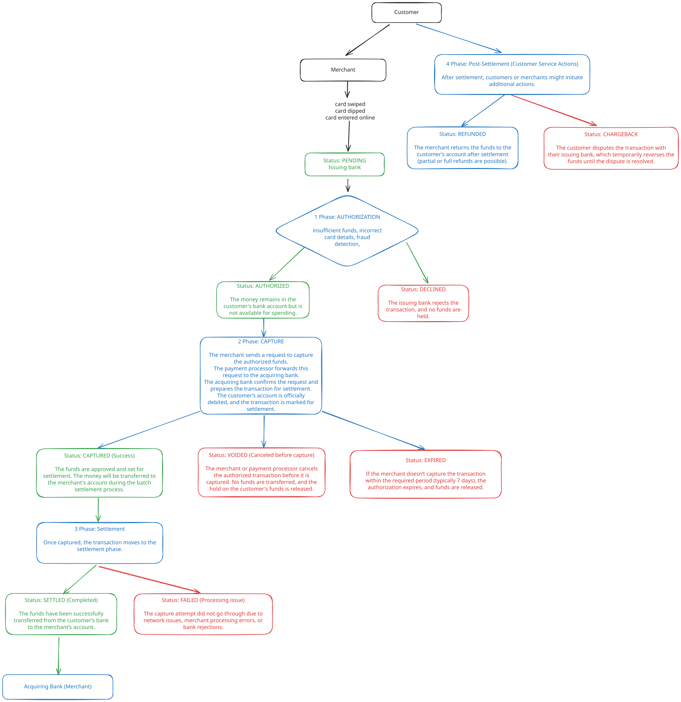

# Fintech basic



## Terms

**Payment Processor**

A payment processor is a company that handles transactions between merchants, acquiring banks, and card networks (Visa, Mastercard, etc.). It facilitates the movement of funds and ensures that payments are securely processed.

A payment processor is the middleman that securely moves transaction data between the merchant, acquiring bank, card networks, and issuing bank.

The payment processor is responsible for:

- Transmitting transaction data between the merchant, acquiring bank, and card network
- Encrypting sensitive payment information to prevent fraud
- Handling authorization requests from card issuers
- Ensuring compliance with security standards (PCI DSS)
- Managing refunds, voids, and chargebacks

Examples of Payment Processors: Stripe, PayPal, Square, Adyen, Worldpay, Fiserv, Authorize.net

**Refund**

A refund is when a merchant voluntarily returns the transaction amount to the customer, typically due to a return, dissatisfaction, or an issue with the product/service.

**Chargeback**

A chargeback is when a customer files a dispute with their issuing bank, asking them to forcibly reverse the transaction.
Merchants should prioritize refunds to avoid chargebacks whenever possible.

**Gross Payments**

Gross Income/Revenue: The total amount of money earned before deductions like taxes, expenses, or costs.

**Net Payment**

Amount of money an individual or entity receives after all deductions, such as taxes, fees, and other withholdings, have been subtracted from the total (gross) amount.

### Resources

[Interchange in 1,000 words - Matt Brown's Notes](https://notes.mtb.xyz/p/interchange-in-1000-words)

[Payfac in 1,000 words - Matt Brown's Notes](https://notes.mtb.xyz/p/payfac-1000-words)

[Payments Basics - Pagos docs](https://docs.pagos.ai/docs/payments-basics): lifecycle, chargebacks, interchange, 3-D Secure

[Authorisation, clearing and settlement explained - Monavate](https://www.monavate.com/learn-articles/authorisation-clearing-settlement-explained)

[How Payments Work - Barking Iguana](https://barkingiguana.com/writing/how-payments-work/)

[Credit card payments cycle - Payabli docs](https://docs.payabli.com/guides/pay-in-cards-cycle-overview)

#### Similar interactive explainers

[How Card Payments Actually Work - debtman.dev](https://debtman-dev.pages.dev/blog/how-card-payments-actually-work):
article with a step-through [lab](https://debtman-dev.pages.dev/lab/card-payments) and a
[quiz](https://debtman-dev.pages.dev/quiz/systems/card-payments)

[Design: Payment System - Neel Mishra](https://neelmishra.github.io/blog/hld/real-world/payment-system.html):
system-design write-up with step-through payment flow and double-entry ledger widgets

## Interactive UI

`ui/` is a small app that explains the concepts above by simulation: payment lifecycle, tokenization, fraud and risk scoring,
settlement, payouts, chargebacks and double-entry bookkeeping, a glossary of the terms they use, plus the aggregates computed from
`transactions/`.

Live: https://fintech-omega-six.vercel.app (deploys from `main` on every push)

```sh
pnpm install
pnpm dev     # local dev server
pnpm test    # model tests in watch mode
pnpm check   # model tests once (CI)
pnpm format  # format with Prettier (format:check for CI)
pnpm build   # static site in dist/
pnpm report  # PDF of the aggregates in transactions/ (page.pdf); needs `pnpm exec playwright install chromium` once
```

| Path            | What it is                                                                                 |
| --------------- | ------------------------------------------------------------------------------------------ |
| `ui/`           | The interactive app (Vite root), one folder per tab                                        |
| `report/`       | The PDF report: transaction types, aggregates (`single-pass`, `multi-pass`) and the script |
| `transactions/` | Sample transactions read by the report and the Repo data tab                               |
| `docs/`         | Images for this README                                                                     |

## Technical decisions

- **Vite + React, no router or UI kit.** Pages are switched by URL hash (`#settlement`). A sidebar groups
  them (overview, the journey steps in the order money moves, reference), each journey step links to the previous
  and next one, and `ui/shared/tabs.ts` is the single list both the sidebar and the overview read. The app is a
  teaching tool, so fewer moving parts beat flexibility.
- **Tailwind for one-off styling, CSS for shared building blocks.** Tailwind v4 (Vite plugin, no preflight)
  styles anything a single tab uses, right in its markup. Its theme maps the app's color tokens (`bg-surface`,
  `text-muted`…), so light/dark switching stays in CSS variables. `ui/styles.css` is only the entry that imports
  `ui/styles/`: `tokens.css` (colors and the Tailwind theme), `base.css` (what many tabs share: panel, eyebrow,
  note, buttons, badges, tables, form controls) and `diagram.css` (the machine diagram, which reads better as named
  CSS). The last two sit in a `components` layer so a utility always overrides them. Inline `style` is left only for values
  computed from data (widths, positions, tones). This roughly halved the hand-written CSS rules.
- **XState for the two flows that are state machines.** The payment lifecycle and the chargeback dispute are
  XState v5 machines (`machine.ts`). The machine is the single source of rules: the UI renders only the events
  `snapshot.can()` allows, guards decide outcomes (auto-capture, evidence wins the dispute), and locks such as
  "scenario can't change once paid" are transitions the machine refuses. Because the rules are data, the
  tests walk every reachable path and fail on an unreachable status, a dead end that isn't final, or
  money created or lost. Trade-offs: ~14 KB gzipped, some typing ceremony, and terminal states are tagged
  `final` rather than `type: "final"` so the actor keeps running and "Start over" works.
- **Diagrams are generated from the machines.** `shared/graph.ts` reads the top-level states (grouped into
  columns by `meta.phase`) and their transitions from the XState definition, merging every event between the
  same two states into one arrow. `MachineDiagram` keeps the states as HTML buttons and draws the arrows in SVG
  underneath from their measured positions, so the layout stays responsive. The arrows the machine accepts now
  are numbered like their buttons (readable without hover, on touch screens too), and hovering a button or an
  arrow highlights the other and shows the full label. A diagram drawn by hand would drift from the rules; a
  graph-layout library would be heavier than the few phases each flow has.
- **Not everything is a machine.** Payouts derive their status from dates, settlement is a fixed stepper,
  the ledger replays an event list into journal entries (event sourcing) and fraud scoring is a pure function.
  Forcing those into XState would add code without adding rules.
- **Explainable fraud scoring over a seeded sample.** The score is additive points (weighted by how much
  likelier each signal is on fraud) rather than a model, so every point can be shown. The threshold trade-off
  runs over 2,000 payments generated with a seeded PRNG from the same signal rates, so the numbers are the
  same on every load and tests can assert them; challenge outcomes are expected values, not random draws.
- **Money in integers where totals must balance exactly.** The ledger works in cents; other models round to
  cents at each step and assert totals within half a cent.
- **Hand-drawn SVG instead of a chart library.** The visuals (state diagrams, the fraud score histogram,
  T-accounts, gauges) are few and specific, so a few lines of SVG/CSS each are simpler than a chart dependency.
  Plots that stretch to the page width (the histogram) draw in data units with `preserveAspectRatio="none"` and
  keep their labels in HTML, so text never scales with the width.
- **One icon per topic.** Icons come from `lucide-react` (tree-shaken, decorative so `aria-hidden` next to a text
  label). `shared/icons.ts` maps each topic to one icon, used for its tab and its glossary heading, so a topic
  always looks the same.
- **The PDF report sits beside the app, in one package.** `report/` keeps the original report together: its
  types, the aggregates and the Playwright script (`pnpm report`). A second `package.json` (pnpm workspace) was
  considered and rejected: the report's tools are devDependencies that never reach the app bundle, both parts
  use React, and the Repo data tab imports `report/single-pass.ts` directly. Revisit if the report becomes a
  real CLI or CI should build the app without the report's tooling. Vitest's root is `ui/`, so `report/` has
  no tests yet.
- **Headless report on the full Chromium build.** Playwright prints PDFs only in headless mode;
  `channel: "chromium"` runs headless on the regular Chromium download, so `playwright install chromium` is
  the only setup (no separate headless-shell build).
- **Build scripts are opt-in.** pnpm 12 refuses dependency install scripts unless approved, failing
  `pnpm install`; `pnpm-workspace.yaml` approves only esbuild (needed by `tsx`, it only checks its binary).
- **File names that differ only by case are avoided.** macOS file systems are case-insensitive, so `actors.ts`
  next to `Actors.tsx` or `report.tsx` next to `Report.tsx` collide; such pairs get distinct names
  (`parties.ts`, `ReportView.tsx`).
- **Prettier formats everything**, including Tailwind class order (`prettier-plugin-tailwindcss`, reading the
  theme from `ui/styles.css`). The config keeps the existing style (double quotes, `x => …` without parentheses)
  with a 120-character line. `pnpm format` writes, `pnpm format:check` is for CI.
- **Illustrative numbers.** Fees, interchange rates, reason codes and deadlines are simplified and labelled as
  such in the UI; they explain the mechanics, not any one processor's pricing.
